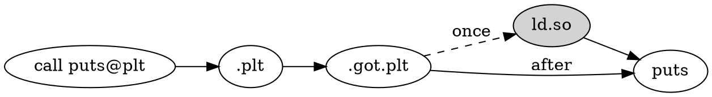

+++
title = "Specimen"
date = 2000-01-01
updated = 2000-01-02
categories = ["notes"]
tags = ["specimen"]

[macros]
'\R' = '\mathbb R'
+++

Everything a post can have, to copy from and to check the design against. This
page is a draft on purpose.[^draft] Text can be *slanted*, **strong**,
~~struck~~ or `code`, and it can [link](/about/) elsewhere.

## Code

A title, a lit line and a marked phrase. Line numbers are links.

```c title="sizeof.c" hl=3 mark="sizeof(arr)"
void randomize(int arr[]) {
    // See https://en.cppreference.com/w/c/language/array
    size_t len = sizeof(arr) / sizeof(int);
    for (size_t i = 0; i < len; ++i)
        arr[i] = rand();
}
```

Notes on lines, which go in the margin like any other.

```rust
impl<T> Drop for Unique<T> {
    fn drop(&mut self) {
        // SAFETY: nothing else has this pointer.
        unsafe {
            self.ptr.drop_in_place(); // [^drop]
            dealloc(self.ptr.cast(), Layout::new::<T>()); // [^free]
        }
    }
}
```

What changed, still coloured as the language it is in.

```nix diff title="flake.nix" start=12
 devShells.default = pkgs.mkShell {
   packages = with pkgs; [
-    hugo
+    cargo
+    rustc
   ];
   shellHook = ''
     echo "hello from ${system}"
   '';
 };
```

Part of a file that sits beside the post, with the dull part folded away.

```rust file=ring.rs lines=9-37 fold=10-21
```

A whole program, which readers can open on Compiler Explorer.

```c run="-O2 -Wall"
#include <stdio.h>

int main(void) {
    printf("%p não aponta para lugar nenhum\n", (void *)0);
}
```

A session. Copying it takes the commands only.

```console
$ cc -O2 sizeof.c \
    -o sizeof
$ ./sizeof | head -n 2
(main) len = 10
(randomize) len = 2
```

What a program printed.

```text
sizeof(ptr) = 8
sizeof(arr) = 20
```

Long lines take over the margin.

```rust
fn lookup<'a>(table: &'a SymbolTable, name: &str, version: Option<&Version>) -> Option<&'a Symbol> {
    table.buckets[gnu_hash(name) as usize % table.buckets.len()].iter().find(|s| s.is(name, version))
}
```

```diff
--- a/build.rs
+++ b/build.rs
@@ -3,2 +3,3 @@
 let mut args = Vec::new();
+args.push("-Clink-args=-Wl,--disable-new-dtags");
```

```asm nonumbers
_start:
    mov  x0, #0     // the null pointer
    ldr  x1, [x0]
```

## Quotations

> Computer science is no more about computers than astronomy is about
> telescopes.
>
> -- attributed to Edsger Dijkstra

A longer one is set at the size of the text.

> An integer constant expression with the value 0, or such an expression cast to
> type `void *`, is called a *null pointer constant*. If a null pointer constant
> is converted to a pointer type, the resulting pointer, called a *null
> pointer*, is **guaranteed to compare unequal to a pointer to any object or
> function**.
>
> -- ISO C, 6.3.2.3, item 3

Lines that end in a backslash are verse.

> Minha terra tem palmeiras,\
> Onde canta o Sabiá;\
> As aves, que aqui gorjeiam,\
> Não gorjeiam como lá.
>
> -- Gonçalves Dias, *Canção do Exílio*

A reply.

> > Arrays are just pointers.
>
> They are not, and the standard says so in several places. It is worth going
> through them one at a time, because each is surprising in a way of its own,
> and none of them is hard.

### Asides

> [!NOTE]
> Something to keep in mind, in your own words. There is also `[!TIP]`.

> [!WARNING]
> Something that bites. There is also `[!CAUTION]`.

> [!IMPORTANT]
> The one thing to take away, which needs no label.

## Mathematics

For $u \in \R^n$ and a subspace $W$, the closest point to $u$ is its
projection[^norm]
$$\operatorname{proj}_W u = \sum_{j=1}^k \frac{\langle u, b_j \rangle}{\lVert b_j \rVert^2}\, b_j.$$

```math
\begin{aligned}
d(u, x) &= \sqrt{\lVert u - \operatorname{proj}_W u \rVert^2
+ \lVert \operatorname{proj}_W u - x \rVert^2} \\
&\geq \underbrace{\lVert u - \operatorname{proj}_W u \rVert}_{d(u, W)}
\end{aligned}
```


Drag the tip of $u$.

## Pictures


The caption is whatever follows the picture, *with* `markup`.


Pictures in one paragraph share a row.


In the margin.

A picture can also stand in the margin, beside the text that talks about it, or
take the margin over. On a narrow screen both go back into the column.


Wide.



## The rest

| Type     | `sizeof` | Decays to |
| -------- | -------: | --------- |
| `int[5]` |       20 | `int *`   |
| `int *`  |        8 | itself    |

- A list
    - inside a list
        - inside a list
- [x] Done
- [ ] Not done

1. First
1. Second

Provenance
: Where a pointer came from.

---

### A smaller heading

#### And the smallest

The end.

[^draft]: Anything under `content/drafts` is only ever seen in the preview.
[^drop]: This runs the destructor, but leaves the memory.
[^free]: And this gives the memory back. The layout has to be the one it was
    allocated with.
[^norm]: If the basis is orthonormal, $\lVert b_j \rVert = 1$.
